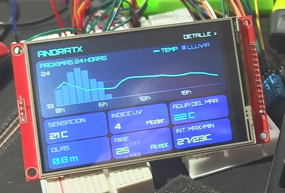

# NH-01 · Reloj y estación meteorológica con ESP32

**NANOHUMANO LABS** · Reloj de escritorio con pantalla táctil de 4", previsión del tiempo, datos del mar y un LED RGB que te dice de un vistazo qué día va a hacer.

- 🎬 Vídeo: _(pendiente)_
- 🖨️ Carcasa en Printables: _(pendiente)_
- 📺 Canal: https://www.youtube.com/@Nanohumano
- 📷 Instagram: https://www.instagram.com/nanohumano

## Qué hace

- **Reloj digital** de siete segmentos con fecha, sincronizado por internet (hora de España con cambio de horario automático).
- **Tiempo de hoy**: estado del cielo, máxima y mínima, viento con dirección, probabilidad de lluvia, salida y puesta del sol.
- **Fase de la Luna**, calculada en la propia placa.
- **Temperatura y humedad interior** con un DHT11 (filtro de mediana contra lecturas sueltas), con máxima y mínima del día.
- **Previsión de 5 días** con iconos, temperaturas, lluvia y viento.
- **Pantalla DETALLE**: gráfica de las próximas 24 horas (temperatura y lluvia), sensación térmica, índice UV, temperatura del agua del mar, altura de las olas, calidad del aire y aviso de calima.
- **LED RGB "un color por dato"** según la previsión de hoy, con transición suave. Cada color dice una cosa y se mezclan:

  | Color | Qué indica |
  |---|---|
  | 🔴 Rojo | **Viento**: empieza a encenderse con 15 km/h y llega al máximo con 50 km/h |
  | 🔵 Azul | **Probabilidad de lluvia**: cuanta más lluvia, más azul |
  | 🟢 Verde | **Buen tiempo**: fuerte si está despejado, más suave con nubes o niebla. Se apaga si llueve o la lluvia pasa del 30 % |

  **Alertas que parpadean:** el rojo con viento de 50 km/h o más; el azul con lluvia fuerte, chubascos fuertes, tormenta o nieve.

- **Brillo de pantalla** automático (baja al ponerse el sol y sube al amanecer) o fijo al 25, 50, 75 o 100 %.
- **Página web interna** (`http://nh-01.local`) con el estilo de NANOHUMANO LABS para ver los datos y cambiar brillo y ciudad desde el móvil.
- **Portal Wi-Fi personalizado** con el logo y los colores del canal.
- **Actualizaciones por Wi-Fi (OTA)** desde el Arduino IDE, sin cable.
- **Ciudad configurable** sin tocar el código: desde el portal Wi-Fi o desde la web.

Datos del tiempo: [Open-Meteo](https://open-meteo.com/) (gratis, sin clave de API).

## Hardware

| Componente | Notas |
|---|---|
| ESP32 DevKit de 30 pines (ESP-32D, 4 MB) | Placa tipo "ESP32 Dev Module" |
| Pantalla TFT SPI 4" 480×320 ST7796S con táctil XPT2046 | Módulo rojo "4.0 TFT SPI 480X320 V1.1" |
| Sensor DHT11 | Módulo de 3 pines (lleva su resistencia) |
| Tira LED RGB analógica de 5 V + 3 MOSFET IRLZ44N | Un MOSFET por color, con resistencia de puerta y de pull-down. El +5V común de la tira va a VIN |
| Condensador electrolítico 10 µF | Entre EN y GND, para que entre solo en modo de carga |

### Conexiones

| Elemento | Pin | ESP32 |
|---|---|---|
| Pantalla | CS · DC/RS · RESET | D5 · D16 · D17 |
| Pantalla | SCK · SDI(MOSI) · SDO(MISO) | D18 · D23 · D19 |
| Pantalla | LED (retroiluminación, PWM) | D13 |
| Táctil | T_CS | D21 |
| Táctil | T_CLK · T_DIN · T_DO | D18 · D23 · D19 (compartidos con la pantalla) |
| DHT11 | DATA | D27 |
| LED RGB | Rojo · Verde · Azul (a la puerta de cada MOSFET) | D25 · D26 · D32 |
| Condensador 10 µF | + / − | EN / GND |

El esquema completo, con el mapa de pines, está en [`docs/conexiones_NH-01.html`](docs/conexiones_NH-01.html). Descárgalo y ábrelo con el navegador.

## Software

**Arduino IDE 2** con el paquete de placas **ESP32 de Espressif (versión 3.x)**.

Librerías (desde el Gestor de bibliotecas):

- `TFT_eSPI` (Bodmer)
- `WiFiManager` (tzapu)
- `ArduinoJson` (Benoit Blanchon, versión 7)
- `DHT sensor library` y `Adafruit Unified Sensor` (Adafruit)

`WebServer`, `ArduinoOTA`, `ESPmDNS`, `Preferences`, `HTTPClient` y `WiFiClientSecure` ya vienen con el paquete del ESP32.

### Configurar TFT_eSPI

La librería TFT_eSPI se configura con un archivo propio. Copia [`firmware/User_Setup_NH01.h`](firmware/User_Setup_NH01.h) a la carpeta de la librería como `User_Setup.h` y, en `User_Setup_Select.h`, deja activa solo la línea `#include <User_Setup.h>`.

### Ajustes del Arduino IDE

| Herramientas | Valor |
|---|---|
| Placa | ESP32 Dev Module |
| Flash Size | 4MB (32Mb) |
| Partition Scheme | Minimal SPIFFS (1.9MB APP with OTA/190KB SPIFFS) |
| Upload Speed | 115200 |

⚠️ Si la placa se queda reiniciándose con `Detected size(4096k) smaller than the size in the binary image header(8192k)`, revisa que **Flash Size** esté en **4MB**: al abrir el sketch en una ventana nueva, el IDE a veces vuelve a 8MB.

Si la subida falla con `Wrong boot mode detected`, mantén pulsado **BOOT** mientras aparece `Connecting...` hasta que salgan los porcentajes. Con el condensador de 10 µF entre EN y GND no hace falta.

## Primer uso

1. Sube `firmware/NH01_v20/NH01_v20.ino`.
2. Si no tiene Wi-Fi guardada, la pantalla muestra las instrucciones: conéctate desde el móvil a la red **NH-01** y abre `192.168.4.1`.
3. Elige tu red, escribe la clave y, si quieres, el nombre de tu ciudad con su latitud y longitud (en Google Maps, clic derecho sobre el sitio).
4. Toca la pantalla para pasar de una pantalla a otra: **Principal → 5 días → Detalle → Control**.
5. Toca el icono de Wi-Fi (arriba a la derecha) para volver a abrir el portal.

### Web interna y OTA

- Con el NH-01 conectado, abre `http://nh-01.local` (o la IP que aparece en la pantalla de control).
- Para actualizar por Wi-Fi, en el Arduino IDE elige **Herramientas → Puerto → nh-01**. La clave por defecto es `nh01`: cámbiala en `CLAVE_OTA` al principio del código.

## Archivos

| Ruta | Contenido |
|---|---|
| `firmware/NH01_v20/NH01_v20.ino` | Firmware completo |
| `firmware/User_Setup_NH01.h` | Configuración de TFT_eSPI para la pantalla de 4" |
| `docs/conexiones_NH-01.html` | Esquema de conexiones con el mapa de pines |
| `fotos/` | Fotos del montaje |

## Versiones

- **v20**: el brillo AUTO de la pantalla ya no sube y baja a ratos (lectura de la hora sin fallos).
- **v19**: nuevo código de colores del LED, "un color por dato", con alertas que parpadean.
- **v17**: primera versión publicada.

## Licencia

MIT · Copyright (c) 2026 Nanohumano Labs. Datos meteorológicos de Open-Meteo (CC BY 4.0).
